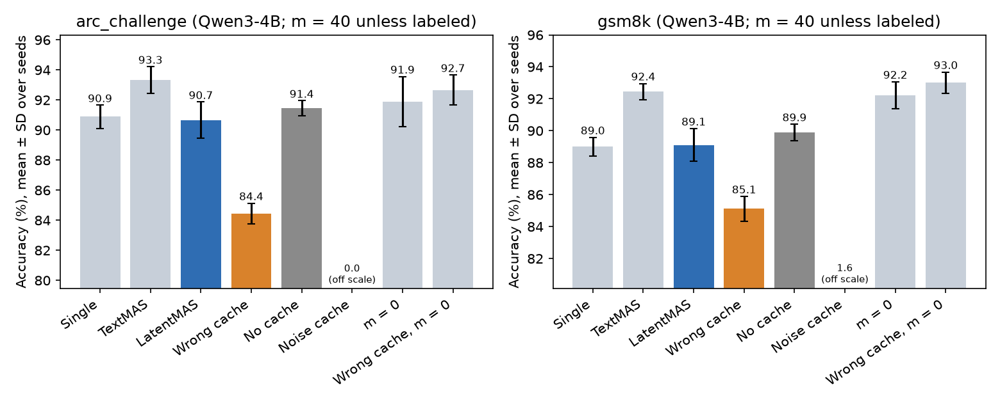

# LatentMAS lab notebook

Dated record of the LatentMAS (latent multi-agent system; Zou et al., arXiv 2511.20639) reproduction and its cache-content controls. Question: does the receiving agent use the sender's specific content, or does any extra cache help? Every number links to a data file.

## Data layout

- `latent/data/{gsm8k,arc_challenge}_300.jsonl`: fixed subsets, 300 test questions each, sampled with seed 0. Rebuild with `python -m gradproposal.latent.bench --n 300 --seed 0`.
- `latent/results/<experiment>/`: one folder per experiment, named as its W&B group (user, 2026-10-13: keep results sorted, locally and in W&B). The same layout is used on HPC.
  - `latentmas-qwen3-4b/`
  - `split-probe/`
  - `cacheback-fanoutqa/`
  - `checks/`
  - `dev/` (smoke runs)
- `latent/results/runs.jsonl`: the run registry, one entry per run with its job, commit, GPU and W&B link.
- `latent/results/<experiment>/*.jsonl`: one row per question × condition × seed (question id, condition, seed, m, answer, correct, tokens, time, peak memory, wrong-cache partner). The first row is run metadata; its `out` field keeps the path at run time, before the 2026-10-13 move into folders. Committed.
- `*.texts.jsonl` next to each file: final solver text per row, for re-scoring. Gitignored (large).
- Code: `src/gradproposal/latent/` (`latentmas.py` method, `bench.py` data/prompts/scoring, `run.py` conditions, `check.py` real-model checks, `report.py` table and plot). Tests: `tests/test_latentmas.py`.

## Setup (2026-10-10)

- **Goal (user, 2026-10-10):** minimal LatentMAS baseline we fully understand, plus wrong-cache, no-cache, noise-cache and m = 0 controls, motivated by the causal audit (arXiv 2608.04893).
- **Compute:** the HPC (high-performance computing) cluster, one A40/L40S/H100 GPU per job (user: "use the hpc or aws"). the desktop only runs CPU (central processing unit) unit tests on tiny random models.
- **Stack:** PyTorch 2.13, transformers 5.19 (same as `swe/`), manual forward passes on `model.model` with `DynamicCache`, `inputs_embeds` for latent steps. No vLLM (a fast inference server): we need cache-level control.
- **Model:** Qwen3-4B (dense, used in the paper), bf16, SDPA (scaled dot-product attention) kernels.
- **Benchmarks:** GSM8K (grade-school math) and ARC-Challenge (AI2 Reasoning Challenge, hard multiple-choice science), test splits, 300 questions each. Paper max length 2,048 new tokens per agent.
- **Sampling (paper):** temperature 0.6, top-p 0.95, 3 seeds (0, 1, 2). Seeds set a per-batch generator, so every condition draws from the same seed stream per batch.

## Method as implemented (`latentmas.py`)

- **Latent thoughts (Section 3.1):** after reading its prompt, an agent takes `m` steps; each feeds `align(h)` back as the next input embedding, where `h` is the post-final-norm last-layer hidden state at the newest position.
- **Alignment:** $W_a = (W_{out}^\top W_{out} + \lambda I)^{-1} W_{out}^\top W_{in}$, $\lambda = 10^{-5}$, fp32, computed once. Then $e = hW_a$ is rescaled to the mean norm of real token embeddings, as the official code does.
- **Transfer (Section 3.2):** the next agent continues from the full cache (every layer, prompts plus thoughts); its rotary positions continue after the predecessor's. Only the solver decodes.
- **Chain:** planner → critic → refiner → solver ("judger" in the code), sequential setting, official prompts verbatim (checked string-equal against `prompts.py`).
- **Hybrid models (Qwen3.5):** same code path, because transformers 5.19 keeps attention KV and Gated DeltaNet recurrent/conv states in one `DynamicCache`; handing on the cache hands on both. Batch size 1 only (padding would leak into recurrent states). Transfer verified exact in fp32 (Checks); no Qwen3.5 benchmark runs yet.
- **Batching:** each agent's prompt is left-padded, so padding sits inside the running cache. A per-row cache mask and next-position counter make each row see exactly what it would see alone (tested).

## Decisions

- **m = 40 for the main runs**, fixed before any results: the paper finds accuracy peaks around 40–80 steps (Qwen3-14B, Figure 8) and the causal audit used 40 per role. Sweep m ∈ {0, 10, 20, 40} on GSM8K.
- **Alignment on (paper-faithful)**, not the official default (identity). For Qwen3-4B the two nearly coincide; see Checks.
- **Thinking on, as in the official example log** (`think: True`): latent agents' prompts end with `<think>`. Single and TextMAS use the plain chat template, which leaves Qwen3 thinking enabled, as in the official code.
- **Interventions act at the solver hop.** Wrong cache: the solver gets the whole planner→critic→refiner cache built for the next question in its batch (a derangement; partner id recorded), with its own question in its prompt. This is the audit's "deranged" arm. It also covers the brief's "solver (and each receiver)": replacing every receiver's incoming cache with the partner's hands the solver this same cache, because each hop's own output is overwritten at the next swap. The only variant that differs keeps the critic's and refiner's real-question prompts in the cache, which is a softer control (closer to m = 0), not a harsher one.
- **Noise cache:** every transferred K and V replaced by Gaussian noise of the same shape, matching mean and standard deviation per row, layer and K/V tensor over real slots (the audit's "random" arm).
- **No cache:** the solver alone with its LatentMAS prompt and an empty cache. Differs from Single only in the prompt, which mentions "latent information".
- **m = 0:** prompt caches of planner, critic and refiner are passed on, no latent steps. Isolates the latent steps' value.
- **Each condition rebuilds its own chain** per batch. Chains are deterministic and cheap next to decoding, so time and peak memory stay clean per condition.
- **Decodes from an empty cache run in chunks under a 100K-token cache budget** (`KV_BUDGET` in `run.py`), after a TextMAS batch of 32 ran out of memory: its critic, refiner and solver prompts carry earlier outputs (up to ~6K tokens). Single and No-cache stay one chunk of 32.
- **Caveat, timing:** time per question is batch wall-clock / batch size, so chunked TextMAS looks slower partly from smaller effective batches. Don't quote a LatentMAS-over-TextMAS speedup from these runs; accuracy and tokens are unaffected.
- **Answer parsing copied from the official code:** last `\boxed{}` (first number inside, else its text), else the last number in the output; lowercase string match.

## Differences from the paper and the official code

- **Official m = 0 drops the cache.** `latent_mas.py` sets `past_for_decoding = past_kv if latent_steps > 0 else None`, so at m = 0 the solver sees nothing from earlier agents (our "No cache"). Our m = 0 passes the prompt caches.
- **Official default m is 0.** `run.py --latent_steps` defaults to 0 and the README's Qwen3-4B command omits it. The official example log (Qwen3-14B, MBPP+) shows `[Latent Steps] 0` with accuracy 76.2% versus the paper's 75.7%. Under the current code that is a solver with no cache; the log was written by an older version ("muscle"), so this is not proof.
- **Official default alignment is identity.** `W_a` is replaced by `I` unless `--latent_space_realign`; the norm rescale always applies. The paper presents the ridge solution.
- **Official batching attends to padding.** It concatenates an all-ones mask over the inherited cache, so a row attends to earlier agents' left padding when batch prompts differ in length. Ours masks it.
- **Official code needs transformers 4.x.** `_past_length` indexes `past[0][0]`, which fails on transformers 5 caches; `check.py` shims it with `get_seq_length()`.
- **TextMAS context truncation:** the official `context[:text_mas_context_length]` with the default −1 drops the last character (a newline). Copied.
- **Prompts mention "latent KV representation"** even in our No-cache and m = 0 arms; copied, since the solver prompt is the official one.

## Checks

Real models on an A40, m = 40, 2–3 questions per benchmark. Data: `latent/results/checks/check-qwen3-4b{,-fp32}.json`, `check-qwen3.5-4b{,-fp32}.json` (`python -m gradproposal.latent.check [--dtype float32]`).

- **Alignment collapses to identity:** Qwen3-4B ties input and output embeddings, so $\|W_a - I\|_F = 8.8 	imes 10^{-5}$. Paper alignment and the official identity default are the same map here; only the norm rescale (to 1.097) acts.
- **Matches the official code exactly:** official `generate_latent_batch` (batch size 1, same weights, prompts, m) gives bit-identical caches (max key difference 0.0) and identical solver logits, all 6 questions, in bf16 and fp32.
- **Theorem 3.3, exact test (`theorem_3_3_exact`):** the reference reads exactly the embeddings the cached path fed (prompts plus recorded latent thoughts) in one pass; logits compared at every solver-prompt position (~170–230).
  - **fp32, dense Qwen3-4B:** max logit gap ≤ 0.002 (logits up to ±58), max KL (Kullback–Leibler divergence) ≤ 2.3e-7, same top token at 100% of positions.
  - **fp32, hybrid Qwen3.5-4B** (KV and recurrent states handed on): max gap ≤ 0.011, max KL ≤ 4.6e-7, 100% top-token agreement. The hybrid transfer is exact.
  - **bf16:** mean KL ~1e-3, top token agrees at 98–99.5% of positions, and the m = 0 control (no latent steps) is just as noisy (dense max KL 0.15; hybrid up to 4.8 at one position). So the bf16 gaps are rounding between a cached pass and one long pass, not the latent transfer.
- **Earlier version (`theorem_3_3`)** recomputed the thoughts in the reference and compared only the first solver token; its bf16 gaps (max logit 3.8–9.3, hybrid KL 0.01–0.08) mixed in drifted thoughts. Superseded by the exact test.
- **Batched versus single rows (real model):** KL ≤ 4e-7 in bf16, ≤ 4e-6 in fp32; same top token, all 6 rows.
- **Tiny-model unit tests (fp32, CPU):** all of the above to 1e-4 or exactly; batched decoding with rows stopping early equals unbatched; hybrid (Qwen3.5-style) Theorem 3.3 holds to 1e-4.

## Results (Qwen3-4B, 300 questions × 3 seeds per cell, m = 40 unless stated)

Data: `latent/results/latentmas-qwen3-4b/{gsm8k,arc_challenge}-{single,textmas,cache,m0,wrong0}-s?.jsonl`, `gsm8k-sweep-s?.jsonl`. Table and plot: `python -m gradproposal.latent.report`. Accuracy is mean ± SD (standard deviation) of per-seed accuracy.

**GSM8K**

| Condition | Accuracy (%) | Output tokens | Time / question (s) | Peak GPU memory (GB) |
|---|---|---|---|---|
| Single | 89.0 ± 0.6 | 878 | 3.89 | 11.4 |
| TextMAS | 92.4 ± 0.5 | 2067 | 20.76* | 36.1 |
| LatentMAS | 89.1 ± 1.0 | 602 | 4.97 | 14.8 |
| Wrong cache | 85.1 ± 0.8 | 646 | 5.20 | 14.8 |
| No cache | 89.9 ± 0.5 | 817 | 3.75 | 11.2 |
| Noise cache | 1.6 ± 0.7 | 2027 | 14.48 | 23.0 |
| m = 0 (prompt caches only) | 92.2 ± 0.8 | 570 | 3.96 | 14.4 |
| Wrong cache, m = 0 | 93.0 ± 0.7 | 619 | 4.25 | 14.4 |

**ARC-Challenge**

| Condition | Accuracy (%) | Output tokens | Time / question (s) | Peak GPU memory (GB) |
|---|---|---|---|---|
| Single | 90.9 ± 0.8 | 834 | 3.81 | 12.2 |
| TextMAS | 93.3 ± 0.9 | 2001 | 16.82* | 30.8 |
| LatentMAS | 90.7 ± 1.2 | 514 | 4.41 | 16.2 |
| Wrong cache | 84.4 ± 0.7 | 542 | 4.62 | 16.1 |
| No cache | 91.4 ± 0.5 | 765 | 3.56 | 12.0 |
| Noise cache | 0.0 ± 0.0 | 2020 | 14.87 | 24.2 |
| m = 0 (prompt caches only) | 91.9 ± 1.7 | 527 | 3.63 | 15.7 |
| Wrong cache, m = 0 | 92.7 ± 1.0 | 523 | 3.56 | 15.6 |

\*TextMAS ran in smaller chunks (memory), so its time per question is inflated; see Decisions. Output tokens count every decoded token across agents.

**Latent-step sweep (GSM8K, LatentMAS):** m = 0: 92.2 ± 0.8; m = 10: 90.9 ± 0.5; m = 20: 91.1 ± 1.1; m = 40: 89.1 ± 1.0. Accuracy falls as latent steps are added.

**Paired differences** (percentage points; same questions and seeds; 95% bootstrap interval over questions; per-seed values):

| Contrast | GSM8K | ARC-Challenge |
|---|---|---|
| LatentMAS − Single | +0.1 [−2.7, +2.8] | −0.2 [−2.4, +2.1] |
| LatentMAS − No cache | −0.8 [−3.4, +1.8] | −0.8 [−2.9, +1.3] |
| LatentMAS − Wrong cache | **+4.0** [+0.1, +7.7]; 3.3, 5.3, 3.3 | **+6.2** [+2.9, +9.8]; 7.0, 7.3, 4.3 |
| Wrong cache − No cache | **−4.8** [−8.3, −1.2] | **−7.0** [−10.3, −3.8] |
| m = 0 − No cache | **+2.3** [+0.7, +4.2] | +0.4 [−1.1, +2.1] |
| m = 0 − LatentMAS | **+3.1** [+1.0, +5.6] | +1.2 [−0.8, +3.3] |
| TextMAS − Single | **+3.4** [+1.4, +5.6] | **+2.4** [+1.1, +4.0] |
| m = 0 − Wrong cache at m = 0 | −0.8 [−2.4, +0.9] | −0.8 [−2.2, +0.8] |
| Wrong cache at m = 0 − No cache | **+3.1** [+1.1, +5.1] | +1.2 [−0.7, +3.1] |
| Wrong m = 0 − Wrong m = 40 | **+7.9** [+4.8, +11.2] | **+8.2** [+5.1, +11.4] |

**Does the solver answer the partner's question?** Share of wrong answers equal to the partner question's gold answer (GSM8K / ARC-Challenge): wrong cache at m = 40: 16% (22/134) / 27% (38/140); wrong cache at m = 0: 0% (0/63) / 14% (9/66); every other condition: 0–1% / 7–10% (ARC chance level, four choices). On GSM8K the partner's answer accounts for about 60% of the extra errors the m = 40 swap causes.

**Against the paper (Table 1, Qwen3-4B, sequential; full test sets):**

| | Single | TextMAS | LatentMAS |
|---|---|---|---|
| GSM8K, paper | 82.4 | 89.8 | 88.2 |
| GSM8K, ours | 89.0 | 92.4 | 89.1 |
| ARC-Challenge, paper | 89.2 | 90.0 | 92.3 |
| ARC-Challenge, ours | 90.9 | 93.3 | 90.7 |

- Our Single is 6.6 points above the paper's on GSM8K, so the paper's LatentMAS gain over Single (+5.8 GSM8K, +3.1 ARC) does not reappear (+0.1, −0.2). Our LatentMAS itself is close on GSM8K (+0.9) and 1.6 below on ARC-Challenge.
- The paper's LatentMAS > TextMAS on ARC-Challenge does not reproduce: TextMAS leads by 2.7 [+1.0, +4.4]. On GSM8K the paper and ours agree (TextMAS ahead).
- Token savings do reproduce: LatentMAS uses 71% (GSM8K) and 74% (ARC) fewer output tokens than TextMAS (paper: 81%, 73%).
- Not tuned to close any gap. Possible sources: 300-question subsets, our Single prompt and thinking setting (official, but the paper's Single runs may differ), and m = 40 rather than a per-task tuned m.

### How much of LatentMAS's gain survives the wrong-cache swap?

All of it, because the gain carries no question-specific content. The only cache benefit appears at m = 0 (prompt caches, no latent thoughts): +2.3 points over the solver alone on GSM8K (+0.4 on ARC-Challenge). Swapping in the prompt caches of a different question keeps it: the wrong cache at m = 0 scores 93.0 vs 92.2 for the right one (difference −0.8, interval includes 0), and beats no cache by +3.1 [+1.1, +5.1]. At m = 0 the swap costs nothing, consistent with the causal audit's equivalence result: extra cache helps whatever it says.

At the paper's latent setting (m = 40) there is no gain to survive: LatentMAS matches Single (+0.1 GSM8K, −0.2 ARC-Challenge) and sits slightly below no cache (−0.8 on both; intervals include 0). Here the latent thoughts do carry question-specific content, but only harmfully: the wrong cache costs 4.0 (GSM8K) and 6.2 (ARC-Challenge) points against LatentMAS, every seed in the same direction. The causal audit, at the same 40 latent steps per role, reported pairing costs of only +1.5 (Qwen3-4B GSM8K) and +0.2 (ARC-Challenge); ours are about 3× and 30× larger. Unexamined possible sources: its fixed training-split items versus our test subsets, thinking settings, and our masking of earlier agents' padding. 16% and 27% of its errors are the partner question's answer, against 0% and 14% for the wrong cache at m = 0. So content crosses the channel through the latent thoughts, and the solver acts on it. But on these benchmarks the right thoughts add nothing over solving alone, and accuracy falls as m grows (92.2 at m = 0 to 89.1 at m = 40).

Moment-matched noise destroys the receiver (0–1.6%): it measures disruption, not the absence of information. This is not a replication of the audit's random arm, whose levels we did not compare.

For the research plan: on tasks the receiver can solve alone, the latent channel transmits specific content but offers no benefit, and the generic benefit of extra cache is content-free. A test of useful transfer needs tasks where the receiver lacks information, as Aim 3 plans, and every result needs the wrong-cache control at the same m.

## Log

### 2026-10-10

- Implementation and tests (tiny random Qwen3, CPU): m = 0 with an empty cache equals greedy `generate`; Theorem 3.3 (cache transfer equals one pass over the concatenated embeddings) holds in fp32 (1e-4) and bf16; batched rows equal unbatched rows; official `generate_latent_batch` gives bit-identical caches and solver logits on the same weights.
- **Single and m = 0, full subsets (300 questions × 3 seeds, Qwen3-4B, A40):** GSM8K Single 89.0 ± 0.6, m = 0 92.2 ± 0.8; ARC-Challenge Single 90.9 ± 0.8, m = 0 91.9 ± 1.7. Data: `latent/results/latentmas-qwen3-4b/*-single-s?.jsonl`, `*-m0-s?.jsonl`.
- **Single versus the paper (Table 1, Qwen3-4B):** GSM8K 89.0 vs 82.4, ARC-Challenge 90.9 vs 89.2. Our subset is 300 of 1,319 / 1,172 test questions; not tuned.
- **Full grid launched (user approved):** TextMAS, cache arms (m = 40) and the GSM8K m sweep; 15 jobs, about 32 GPU-hours (`scripts/latent_grid.sh long`).
- **Two failures, both resumed:** a TextMAS batch of 32 ran out of GPU memory (fixed by chunked decoding under `KV_BUDGET`), and one TextMAS job exceeded 32 GB host memory (now 64 GB, `MALLOC_ARENA_MAX=2`). Finished batches were kept; no rows lost.
- **Grid complete:** all 7 conditions × 2 benchmarks × 3 seeds × 300 questions, plus the m sweep. See Results.
- **Review additions:** wrong-cache errors checked against the partner's answer (no compute); wrong cache at m = 0 added (6 jobs, ~20 min each), since m = 0 is the only setting with a gain; exact Theorem 3.3 check in bf16 and fp32 for dense and hybrid models.
- **Lint:** `uv run ruff check .` fails only on `grfp/figures/make_figures.py` (not part of this task; left untouched). `src/` and `tests/` pass.

## Next steps

- **Next for latent communication (user, 2026-10-16):** *N* summaries per turn instead of the full cache. After a turn, each worker writes *N* summary positions, and only their KV (all layers) is sent (`grfp/directions.md`, Sections 3 and 7). This is separate from the `memory` branch.
- **Latent-only arms (added 2026-10-16, not run; wait for go):** do untrained latent positions alone carry the facts? This decides whether a summary compressor must be trained. `split.py` arms `latentonly` (the solver sees only the m latent positions plus the sender's first token as an attention sink; prompt slots masked out, positions kept as written) and `wrongonly` (the same on the partner's cache). Compare against latent (91%) and nocache (0%). Dense models only. Sweep m (e.g. 16, 40) with `--m`. Tests: hidden slots don't affect the solver; mask correct under left padding.
- **Open (optional):** fair speed comparison at batch size 1 on ~20 questions; a softer wrong-cache arm keeping the receivers' real-question prompts.
- **Then CacheBack** (`prompts/reproduce_cacheback.md`), on branch `cacheback` from `latentmas`.
- **For CacheBack, positions:** `Chain.mask` already represents a kept subset of cache slots. Keys are stored after rotary embedding, so placing them in a fresh block of positions (`grfp/directions.md`, Section 5) needs an un-rotate/re-rotate step.
- **For CacheBack, hybrid:** Qwen3.5 recurrent states were numerically touchier than KV (see Checks); record carefully how CacheBack treats Nemotron's Mamba layers.

## Split-information probe (designed 2026-10-13, not run)

**Why:** in the runs above every agent sees the whole question, so nothing needs to cross the channel. This probe gives the receiver a task it cannot solve alone, the regime where the causal audit (arXiv 2608.04893) found 100% vs 23–25%.

**Design (user, 2026-10-13: a few arms, small probe, wait for go before running):**
- **Task:** GSM8K split into facts (all sentences but the last) and the question (last sentence). Kept only if the question ends in "?" and has no digit. The first 100 clean questions of the fixed 300 subset are used (165 of 300 split cleanly).
- **Two agents, one Qwen3-4B:** the sender holds only the facts; the solver holds only the question.
- **Arms:**
  - **latent:** sender reads facts, then m = 40 latent steps; the solver continues from its cache.
  - **wrong:** as latent, but with the next question's sender cache.
  - **nocache:** the solver alone (floor).
  - **text:** the sender writes a message (thinking on, up to 2,048 tokens), and only the visible part after `</think>` is passed. The solver prompt is the LatentMAS one with the latent slot replaced by the message.
- **Size:** 100 questions × 1 seed (0). A 95% interval on the paired difference is about ±7 points, enough to decide a 10-point line.
- **No tuning:** frozen model, official sampling (T 0.6, top-p 0.95), m = 40 and prompts fixed before any run.
- **Kill criterion (fixed before running):** if latent − wrong is under 10 points, the latent channel is not carrying the facts usefully at m = 40.
- **Compute delta, text vs cache, per question:**
  - estimated forward FLOPs for the sender, the solver prompt and the solver answer (`split.forward_flops`: weights plus attention pairs; norms, rotary and softmax left out);
  - message size (KV-cache bytes for latent, visible tokens and bytes for text);
  - measured seconds per stage (batch wall-clock / batch size, so a `--batch-size 1 --n 20` run is needed for fair timings).
- **Code:** `src/gradproposal/latent/split.py` (`python -m gradproposal.latent.split --out latent/results/split-probe/split-gsm8k.jsonl`, then `--report`). Tests: `tests/test_split.py`:
  - the split rule;
  - FLOPs equal a brute-force sum and are additive;
  - KV bytes equal the real cache size;
  - all four arms run on a tiny model, and the wrong arm equals the latent arm on the partner's facts.
  - The full suite passes on the desktop (39 tests, CPU).
- **Status:** run 2026-10-13 (user go). Results below.

### Results (Qwen3-4B, 100 questions × 1 seed, m = 40)

Data: `latent/results/split-probe/split-gsm8k.jsonl` (job 21812868, H100 MIG 4g.40gb slice, batch 25, commit 76a2743). The first 100 clean questions needed 188 of the 300 subset (88 skipped). Table: `python -m gradproposal.latent.split --report latent/results/split-probe/split-gsm8k.jsonl`.

| Arm | Accuracy (%) | Message | Sender TFLOPs | TFLOPs to answer start | Total TFLOPs | Answer tokens |
|---|---|---|---|---|---|---|
| Right cache | 91.0 | 25.0 MB KV (178 positions) | 1.30 | 2.25 | 6.12 | 470 |
| Wrong cache | 0.0 | 25.0 MB KV | 1.30 | 2.25 | 5.10 | 340 |
| No cache | 0.0 | none | 0 | 0.92 | 5.04 | 501 |
| Text | 92.0 | 111 tokens (sender generated 726, thinking included) | 7.16 | 9.12 | 14.44 | 590 |

Medians per question. TFLOPs are estimates from token counts (`split.forward_flops`).

**Paired differences** (points; 95% bootstrap interval over questions):
- right − wrong: **+91.0** [+85, +96];
- right − no cache: **+91.0** [+85, +96];
- text − no cache: **+92.0** [+86, +97];
- right − text: −1.0 [−7, +5].

**Kill criterion passes** (91 ≫ 10).

**Measured time at batch size 1** (`split-probe/split-gsm8k-timing.jsonl`, job 21812869, first 20 questions, H100 NVL; medians in seconds):

| Arm | Sender | Solver prompt | Solver total | Accuracy |
|---|---|---|---|---|
| Right cache | 0.79 | 0.05 | 9.0 | 20/20 |
| Text | 15.0 | n/a (not separated in the text path) | 10.6 | 19/20 |
| No cache | 0 | 0.02 | 8.1 | 0/20 |

**Reading:**
- **The cache carries the facts.** The solver cannot answer from the question alone (0%), a different question's cache gives 0%, and the right cache gives 91%.
- **Text does as well (92%).** On this task latent and text are tied on accuracy (−1 point, interval ±6).
- **Latent is cheaper to produce.** The sender takes 0.8 s instead of 15 s (about 19×), because it prefills the facts and takes 40 steps instead of writing about 790 tokens. Total FLOPs per question are 2.4× lower (6.1 vs 14.4 TFLOPs).
- **Latent is far bigger to send.** 25 MB of KV against 111 text tokens (under 1 KB), about 50,000×. This only matters when agents run on different devices.
- **Caveat: this is context sharing, not compression.** The cache includes the facts' own KV, so the solver can read the facts directly. The probe shows the channel works; it does not show that the 40 latent steps add anything (user, 2026-10-13: not needed).
- **Token limit:** solver answers hit the 2,048-token limit in 2 right-cache and 6 text questions. 2 text senders hit it inside their thinking, so their whole output was sent (flagged `sender_closed: false`).

# CacheBack

Reproduction of CacheBack (Rossi et al., arXiv 2609.32046, "Receiver-conditioned latent communication gives 94% CacheBack") on FanOutQA (multi-hop questions over Wikipedia), against same-size text. Brief: `prompts/reproduce_cacheback.md`. Branch `cacheback`.

## Sources read (2026-10-11)

- Paper PDF (`papers/latent-comm/2609.32046_CacheBack_receiver_conditioned.pdf`): Sections 2–4, Appendices C (selector), E (results), F (settings, scoring), G (prompts, packing).
- Official code, github.com/maxr0ssi/rclc:
  - `paper-v1` tag (the paper's replication snapshot, vLLM-based): `src/rcc/models/qwen/{engine,capture,producer,prompts,receiver}.py`, `src/rcc/latent/rollout.py`, `src/rcc/transforms/select/query_support/`, `src/rcc/topologies/fanout/layout.py`, `src/rcc/benchmarks/fanoutqa/{prompts,scoring_core,scoring_equivalence}.py`, `src/rcc/run/handoff_recall.py`, `src/rcc/models/nemotron/`.
  - `main` branch (a smaller Hugging Face API for dense Qwen3): `src/rclc/selectors/`, `latent.py`, `transport.py`.
- The prepared FanOutQA panel ships with `paper-v1` (`data/fanoutqa-m3-source-*.tar.zst`): 50 questions, 3 workers each, worker texts already cut.

## Data and code layout

- **Panel:** `latent/data/fanoutqa_dev50.jsonl.gz` holds the 50 panel questions with the raw FanOutQA gold answer, each sender's evidence text and page provenance (page id, title), and the official rendered-prompt token count. Rebuild from the unpacked `paper-v1` archive with `python -m gradproposal.latent.bench --fanoutqa-bundle DIR`. Reference corrections and aliases are the official JSON files, in `latent/data/fanoutqa/`.
- **Code:** in `src/gradproposal/latent/`:
  - `cacheback.py`: sender roll, receiver-conditioned scores, span selection, message rows, receiver prefill;
  - `fanoutqa.py`: scoring and message recall, ported from the official code;
  - `cb_run.py`: stages `produce`, `text` and `receive`;
  - `cb_check.py`: comparison with the official code on real weights;
  - `cb_report.py`: table and plot.
- **Tests:** `tests/test_cacheback.py`.
- **Results:**
  - `latent/results/cacheback-fanoutqa/cb-<arm>.jsonl`: one row per question × arm × draw;
  - `cb-text-reports.jsonl`: the text senders' reports;
  - `cb-bank/` (gitignored, on HPC): per question, the senders' prompt ids, latent vectors and score vectors.
- **Prompt-length check:** our rendered sender prompts reproduce the official renderer (`worker_prompt`, enable_thinking=True, no system prompt) and the bundle's content token counts exactly. The bundle's own "rendered prompt" metadata counts 12 more tokens per prompt (for example 45,105 vs 45,093). No code path in `paper-v1` produces those 12 tokens, so we follow the code. Our prompts are 40,116–50,116 tokens.

## Method as implemented (paper + official code)

**Task and topology (FanOutQA, fan-in).** Three senders each read a different slice of the question's Wikipedia pages (40K–50K Qwen tokens per sender, 122K–150K per question), then one receiver answers from their messages. Senders and receiver are the same model (Qwen3-8B in the paper's Qwen runs).

**Sender.** Its prompt is the "natural" worker prompt (Appendix G.1; the official string has fixed line breaks that are part of the prompt bytes) rendered with the chat template and `enable_thinking=True`; no `<think>` is appended by hand. The sender prefills the prompt minus its last token, then feeds that last token, then takes **40 latent steps**. Each step feeds the last hidden state back as the next input embedding, rescaled to the mean token-embedding norm. **For Qwen the alignment matrix is off** (Table 11; `build_realign(..., enabled=False)`), so it is a pure norm rescale. The sender sequence is T_i = prompt tokens + 40 positions. The sender never decodes text in the latent arms.

**Receiver query (how q is formed).** q is the receiver's own prompt: the full rendered coordinator prompt of the text channel, with no reports in it. It is appended to the sender's finished cache (a disposable copy) and run forward once. Only the attention from the rows of the question text inside that prompt is scored, and only over the T_i sender positions. The coordinator's opening sentence sits before the question, takes part in the softmax, and is not scored. q is used only for scoring; it is not kept in the message.

**Scoring.** All layers for a dense model. Let a be the attention from question row r, query head h, layer l, to sender position t (softmax over sender positions plus the query's own causal prefix).
- Mean query attention: Q_t = Pool7(Σ_l mean over r and h of a). Pool7 is a max-pool over 7 neighbouring positions.
- CacheBack correction: first average the query heads that share each KV head, giving b_{s,r,t}. Then E_t = Σ_{l,s} [Pool7(mean_r b)]² and R_t = Σ_{l,s} mean_r [Pool7(b)²], with C_t = R_t / E_t (1 when both are 0).
- Score: S_t = Q_t · C_t² (p = 2, α = 2, fixed on 13 held-out development questions). Position 0 is then pinned to the maximum score.
- **Receiver-independent selectors** (StreamingLLM, H2O, ChunkKV, KVzip) rank positions without q. They appear only in the selector study (Figure 4, Appendix D), not in the end-to-end runs; we do not run them.

**Budgets and selection.**
- **Relative r×:** each sender keeps B_i = ⌈T_i / r⌉ positions.
- **Fixed:** B_i = min(B_max, T_i). It matters only in the LongBench chain, where inherited positions accumulate; FanOutQA uses Relative only.
- **Protected positions**, counted inside the budget: position 0 and all 40 latent positions.
- **Filling the rest:** the rest of the budget is filled with 16-position spans on a fixed grid from position 0, ranked by mean score. When the next span would overshoot, the contiguous interval of free positions closest to that span's peak fills the remainder. Kept positions are returned in source order.
- **Main operating points** for Qwen: 4× (best accuracy, 55.3% strict) and 16×. The paper sweeps 2×–128×.

**Message and placement in the receiver.**
- **What is sent:** continuous rows, the input-embedding rows of the kept positions. For kept prompt tokens these are token embeddings; for latent positions they are the fed latent vectors. Per sender the block is [kept prompt rows in source order][40 latent rows]; the three blocks are concatenated in worker order.
- **How the receiver uses it:** the receiver prefills `[message rows][complete rendered coordinator prompt]` from scratch as input embeddings at dense positions 0..N−1, with an all-ones mask.
- **No KV moves:** no sender KV, positions or rotary phases are transferred, so there is no position mismatch to handle. Senders also attend to earlier senders' rows inside the receiver.
- **Token-ID encoding:** a variant that sends token ids for prompt positions; it gives the same receiver input and is not used for reported runs.

**Receiver decoding.** Qwen3-8B, YaRN rotary scaling ×4 over 32,768 (131,072-token window) on senders and receiver. Temperature 0.6, top-p 0.95, top-k 20, thinking on. Up to 24,000 new tokens. A draw that ends inside an unclosed `<think>` gets `</think>` injected and continues for up to 4,096 tokens with the same seed. Three receiver draws per question. Sender state, scores and selections are deterministic, and text reports are generated once, so all three draws see the same message.

**Text arms.** The sender decodes a report (thinking on, up to 24,000 tokens). Only the text after `</think>` is sent; the receiver gets it in the "Worker reports" slot of its prompt. **"Same-size text" means a text sender of the same model size as the receiver** (Qwen3-8B), not a token-matched message: "Text message lengths are not set from the latent message budgets." Smaller text senders (1.7B, 4B) are the "Small" and "Medium" arms.

**Metrics.**
- Strict accuracy: every reference group appears in the visible answer, after `</think>`, under a normalized string match with the paper's 9 reference corrections and its equivalence rules.
- Loose accuracy: the fraction of reference groups found.
- Message recall: the fraction of the 495 reference groups present in the three messages, counted once per question and arm, not per draw. For text, the three visible reports. For CacheBack, each sender's kept prompt tokens decoded one contiguous run at a time, so no reference string can form across a dropped position. Prompt framing, which contains the question, counts; latent rows are excluded. The ceiling is 96.4% (477 of 495): 18 groups appear nowhere in the senders' prompts.
- Latency: time to end of answer, median over 50 concurrent tasks on an 8-GPU node.

**Hybrid models (Nemotron Nano 2, Mamba + attention).**
- **Scoring uses only the attention layers.** Nemotron has 6 of 62; Gemma, with sliding-window attention, uses its 8 global layers. In `paper-v1`, `NemotronFamily.score_adapter` returns no adapter and refuses any other recipe ("active Nemotron arms require attention-only selection").
- **The Mamba-history selector is unused.** The repository also contains a Mamba-history selector (`nemotron-support-mamba-write20-anchor90-read10`, `mamba_history.py`). It is reachable only with `observe_mamba=True`, which is off by default, and no reported arm uses it.
- **Nothing recurrent is transferred.** The message is continuous rows, so the receiver recomputes Mamba (and attention) state over the selected rows from scratch.
- **Sender side:** the latent rollout runs through the hybrid cache with recurrent state kept in fp32 (`nemotron/cache.py`). The alignment matrix is on for Nemotron.
- **Placement:** inside the user turn, behind `[worker i report]` headers, not prepended as for Qwen.
- **Implication for Qwen3.5 (Gated DeltaNet + attention, 3:1):** score with its full-attention layers only, send rows, re-prefill. Our batch-1 hybrid path already covers the sender side.

## Decisions (fixed before any CacheBack runs)

- **Model: Qwen3-8B for senders and receiver**, the paper's Qwen receiver (the largest Qwen3 it uses). bf16, SDPA kernels, YaRN ×4 as in the paper. Transformers 5.19 on our stack instead of vLLM 0.11.1 plus a transformers 4.57 view. We need attention capture and row-level control; the receiver could move to vLLM's prompt-embedding input later if Hugging Face decoding is too slow.
- **Data: the official 50-question panel**, unchanged. It is already a fixed, seeded subset: the first 50 qualifying dev ids by SHA-256 of the question id, with the 30 selector-development questions excluded. Worker texts are copied with page provenance into `latent/data/`, which keeps the comparison with the paper exact.
- **"Same-size text" follows the paper:** a Qwen3-8B text sender with the paper's report ceiling, length not matched to the latent message. The brief asks for "same number of tokens as the latent message (the paper's 'same-size text')". The two definitions disagree; the paper's is the one its numbers use. We record each report's length next to the latent budget (about 12K positions per sender at 4×, 3K at 16×). If reports turn out longer than the 16× budget, a capped text arm will be added and reported separately.
- **Not run, as in the paper:**
  - Full rows (all positions of all three senders, about 146K) and one agent given all articles (122K–150K tokens plus prompt and output) do not fit Qwen3's 131,072-token window. The paper also reports "Exceeds context limit" for Qwen.
  - We do not truncate articles to force a fit, because that would change the task.
  - Test 1 still checks the full-relay identity on one sender (Checks).
- **Wrong and noise messages at 4× (the main operating point):**
  - Wrong: the receiver gets the message built for its partner question (next question in the panel, wrapping around), with its own question in its prompt.
  - Noise: Gaussian rows with each message row's mean and standard deviation.
  - Both reuse banked sender work.
- **Seeds = 3 receiver draws (0, 1, 2) over one fixed message**, as in the paper. The sender state, scores, selections and text reports are computed once per question.
- **Answer ceiling:** chosen from a pilot before the full run (the paper allows 24,000 tokens plus the 4,096-token closer). The truncation rate will be recorded.

## Checks (CacheBack)

- **Test 1, 100% keep equals the full-cache relay** (`test_full_keep_equals_full_cache_relay`, tiny random Qwen3, fp32). At ratio 1 every position is kept. The receiver that re-prefills the message rows then gives the same logits, at every receiver-prompt position, as handing it the sender's own cache (LatentMAS relay), within 1e-4. With several senders the two differ by design: after re-prefill, each sender's rows attend to the earlier senders' rows.
- **Scores equal the formulas** (`test_scores_match_explicit_attention`): the fused capture reproduces Q_t and S_t computed from eager attention weights, and leaves the sender cache unchanged. Batched and chunked receiver prefill match single rows. The hybrid (Qwen3.5-style) path scores with its attention layer only and keeps recurrent state intact.
- **Test 2, against the official code on real weights** (`python -m gradproposal.latent.cb_check`, Qwen3-8B with YaRN, A40, bf16). Two panel questions × 3 senders, evidence cut to 60,000 characters (T = 14K–24K positions per sender). Data: `latent/results/cacheback-fanoutqa/cb-check-short.json`.
  - **Bit-identical (difference 0.0):**
    - prompts: worker, coordinator and question rows, compared with `prompts.py`;
    - latent vectors and sender cache keys, compared with `latent_rollout`;
    - mean-query-attention and CacheBack scores, compared with `capture_qwen_scores`;
    - kept positions at 4× and 16×, compared with `qwen_w16_keep` (our port also returns the official keep from the official scores);
    - message rows, compared with `interleaved_blocks`.
  - **Receiver next-token distribution** after [message rows][coordinator prompt] (11K–14K positions), compared with the official `cat(payload, manager)` input-embedding forward: KL ≈ 1e-8, same top token. The remaining logit gaps (max 1.2) are bf16 rounding between our chunked prefill and one long forward.
  - A full-length run (50K-token senders) was queued for an 80 GB GPU.
    - Its output, `latent/results/cacheback-fanoutqa/cb-check.json`, was found on HPC and fetched on 2026-10-13. It has not been reviewed yet.
    - At first glance it is not bit-identical to the official code (first worker, T = 45,133: latent max difference 0.02, cache-key max difference 8.0), unlike the short check.
    - Review before any CacheBack run.
  - **Reviewed 2026-10-16.** The drift came from the H200, not from the port:
    - **Prompt mismatch (c58ac65553f24640, worker 0) is cosmetic.** The official `worker_prompt` decodes evidence ids back to text. The tokenizer NFC-normalizes, so decomposed IPA accents (u + combining acute) come back composed. Token ids are identical for all 150 panel prompts (checked on the HPC login node); only 2 strings differ (also 50fa232e3f44887a, worker 0).
    - **H200 run (job 21767117):** both rolls start from the same copied cache with the same calls, yet latents differ by ≤ 0.02 and keys by ≤ 8. Support scores differ by ≤ 1.4% relative, keeps overlap 96.6–98.7%, and the selector fed the official scores still returns the official keep. Receiver KL ≈ 1e-7, same top token.
    - **Same check on an A40 (job 21846585, `cb-check-a40.json`): bit-identical.** Latents, cache keys, scores, keeps at 4× and 16× and payload all differ by 0.0, on all 6 senders at 45K–50K tokens. Receiver KL ≈ 5e-8, same top token (max logit gap 1.3, bf16 chunked vs one-pass prefill, as in the short check).
    - **So the H200 run is not reproducible call to call** (its attention kernels at long context are presumably nondeterministic). The port is verified at full length.
    - **For CacheBack runs:** pin one GPU type per experiment (`--constraint`) and record it, since sender state and keeps can shift by a few percent across GPU types.

## MASBench Reasoning (goal set 2026-10-26; `docs/GOAL.md`)

Target: beat 59.24 F1 (Qwen-Plus, Protocol; Chu et al., arXiv 2610.04672) on the 300-question two-agent Reasoning track, accuracy only. Code: `src/gradproposal/latent/masbench.py` (loader, MASBench-identical scoring, arms latent / wrong / nocache / text / both on the Alice -> Bob split), `private/masbench/` (vLLM text baseline through MASBench's own harness), data `latent/data/masbench_reasoning.json.gz`.

### 2026-10-26: text baseline smoke, Qwen3.8-27B-FP8

- **Setup:** MASBench's own prompts, Protocol loop and F1, run concurrently (8 questions in flight) against vLLM on one L40S (46 GB). Paper settings: 10 turns, 4,096 tokens, temperature 0. 30 stratified questions (20 easy, 10 hard, seed 42). Job 21953004; data `latent/results/masbench/text-baseline/reasoning-qwen3.8-27b-21953004.jsonl`.
- **Result: F1 56.83** (paper rule, 1 of 30 unanswered); 58.79 by the public script's rule (unanswered omitted). Easy 54.16, hard 62.17. Published best 59.24. With n = 30 the interval is about +-9 points, so this is "in the same band", not a ranking.
- **Cost:** 3.2 turns and 135 message words per question; 155 s per question, 707 s wall for 30. A full 300 at this concurrency is about 2 h on one L40S; raise `--workers` to 16 (`--max-num-seqs` allows 32) to halve it.
- **Two fixes the run needed:** (1) Qwen3.8 is a hybrid; vLLM's default 256 sequences exceeds the ~166 recurrent-state blocks that fit, so `--max-num-seqs 32`. (2) Qwen's chat template rejects a request with no user message, and MASBench's opening turn is system-only; the driver adds a one-word user turn ("Begin.") on that request only. The API models in the paper did not need it, so our opening token sequence differs slightly from theirs.
- **Scoring quirk worth knowing:** several low-F1 answers were right but short ("Xylos Institute") against full-sentence references ("Xylos Institute dedicates more of its ..."); word-level F1 rewards restating the question's terms. Answer length is a lever for the text baseline; for our arms, the solver prompt should ask for the full answer in the reference's form.
- **Dataset note:** two released questions (`sample_78`, `sample_178`, same content) list empty-string supporting facts; the loader test skips empty facts. Every non-empty fact sits in exactly one agent's half.

### 2026-10-26: CPU pre-flight, Qwen3.5-2B

`python -m gradproposal.latent.masbench --model Qwen/Qwen3.5-2B --arms nocache,latent --limit 1 --m 8 --max-new-tokens 256` on the desktop CPU: both arms ran end to end in 41 s (11 s per 256-token answer); F1 0 because 256 tokens is too short for a thinking model to reach `<A>`, as expected. Purpose: real tokenizer, chat template and `<A>` parsing before a GPU job; not a number.

### Next

Milestone 0 (text baselines on all 300: single agent both halves, one half, Protocol as published), then milestone 1 (full-cache and wrong-cache on the 27B through `masbench.py`, batch size 1, H100 for bf16).
